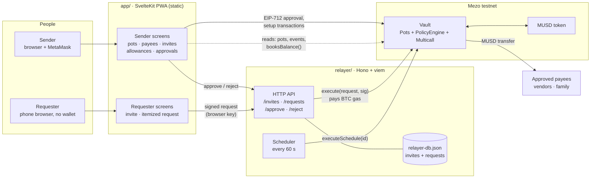
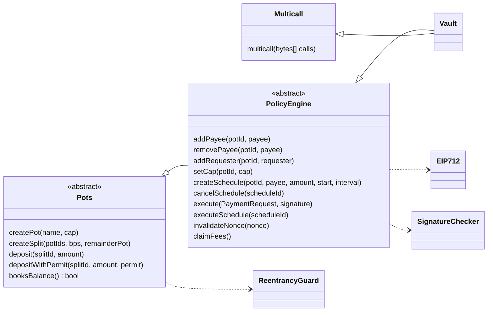
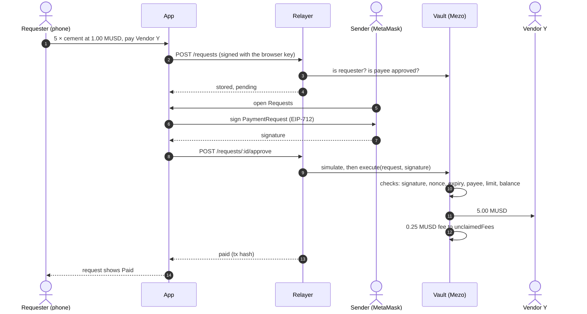
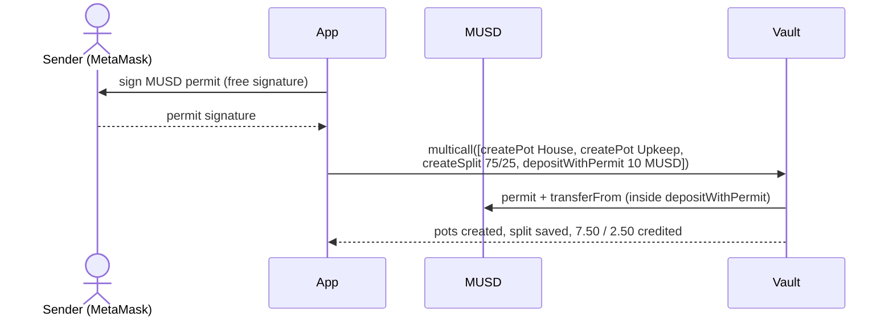
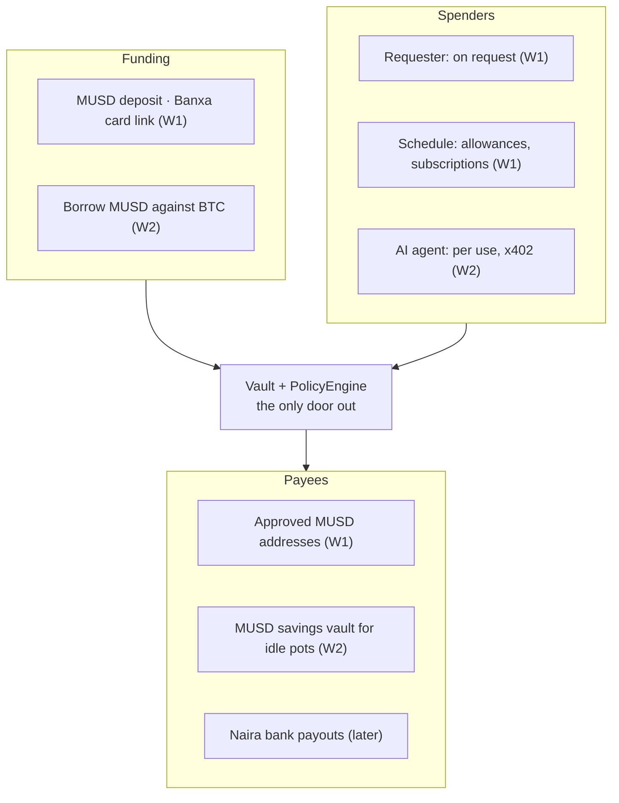

# Ìpín: Purpose-Bound Money

**Mezo Buildathon (AKINDO) · Wave 1 · Track 2 (Access and Distribution), with Track 1 elements**

Ìpín (working name, Yoruba for "share") lets you send money for a purpose, and makes sure it can only be spent on that purpose. The money waits in MUSD (Mezo's Bitcoin-backed dollar) until it's needed (and, from Wave 2, earns in Mezo's savings vault), and every cent is provable on-chain.

> **One-liner:** You decide what your money is for, not whoever receives it.

Full plan with diagrams: https://claude.ai/code/artifact/105aeb55-658d-427b-be6e-c1a16a736b93

Wave 2 and beyond (subscriptions, x402 agent budgets, borrow-to-pay checkout, templates): [docs/wave2.md](docs/wave2.md)

---

## What it is

Ìpín is purpose-bound money on Mezo. A sender abroad splits MUSD into named pots, such as House and Upkeep, in one transaction. Family or a site manager request items from their phone with no wallet and no gas. The sender approves with one signature, and the vendor is paid directly from the pot, never through the person who asked. Upkeep pays capped monthly allowances automatically. Every payment passes one on-chain policy engine (approved payees, monthly limits, signed approvals), and a live `booksBalance()` check lets anyone verify that the vault covers everything it owes.

- **Live app:** https://ipin-ten.vercel.app
- **Demo video (2 min):** https://youtu.be/MmmpK6DZjj0
- **Pitch deck:** [Google Slides](https://docs.google.com/presentation/d/1TV1C-6S-KPhzUcZUcKJrSV19zjBCZ63WyillbbS2ReY/edit?usp=sharing)
- **Live on Mezo testnet:** Vault [`0x6da24cb091A69bc3026B233DBdD146cEb3b72727`](https://explorer.test.mezo.org/address/0x6da24cb091A69bc3026B233DBdD146cEb3b72727)
- **Try it:** [docs/demo.md](docs/demo.md) walks through the house story click by click, including what the contract refuses.

---

## Start here (for whoever picks this up next)

Status: **Wave 1 built end to end on Mezo testnet.** What's done and what's left: [docs/status.md](docs/status.md). Walkthrough for judges and the video: [docs/demo.md](docs/demo.md).

1. Read this whole file. The **Scope** section is the source of truth: nothing from Wave 2 goes into Wave 1.
2. Follow the order: rules document → failing tests → contracts → relayer → adapters → screens.
3. Every money rule (R1–R10) gets a test that fails first, then the fix (the Penny method, see Credits).
4. Every payment must go through the same path: **signed request → policy check → settlement.** No shortcuts for any use case.
5. Check the **Open questions** before building anything that depends on them.

---

## The problem

Once money lands at home, the sender loses control of it, and while it waits the naira erodes its value.

The lead story: *"I sent $1,000 home to build my house. Six months later, the money was gone and the foundation wasn't done."*

## Roles

| Role | Who | What they do |
| --- | --- | --- |
| Sender | A Nigerian abroad (UK, US, Canada, Gulf) | Funds pots, sets rules, approves requests |
| Requester | A relative or site manager | Raises purchase requests from a phone |
| Payee | Vendors, builders, family members | Receive money directly, within the rules |
| Agent (Wave 2) | An AI agent with a budget | Pays services per use, under a cap |

## Core flow: building a house with $1,000

1. The sender funds the vault in MUSD (card via Banxa, or an MUSD transfer). It splits into a **House** pot ($750) and an **Upkeep** pot ($250, shared by two people).
2. The site manager raises a request: "200 bags of cement, Vendor Y, ₦X each."
3. The sender checks the price and approves on their phone with one signature.
4. The policy engine checks the pot, payee, cap and nonce; the relayer settles; the vendor is paid directly, never through the requester.
5. The Upkeep pot pays each person a capped monthly allowance automatically.
6. Unspent money sits in the MUSD savings vault, and the statement shows the books balance.

## Ways money leaves a pot

| Mode | Trigger | Example | Wave |
| --- | --- | --- | --- |
| On request | Requester asks, sender approves | 200 bags of cement | 1 |
| On schedule | A date, within a cap | Monthly upkeep allowance | 1 |
| Per use | A service charges per call (x402), under a sender mandate | An AI agent paying for tools | 2 |
| Borrow to pay | The sender borrows MUSD against BTC and pays a merchant in one transaction | Paying at checkout without selling BTC | 2 |

The same engine covers school fees, medical bills, small-business stock, grants paid by milestone, subscriptions and agent budgets. Each is a configuration, not a new feature. Recurring payments already work in Wave 1: a schedule to an approved payee is a subscription. See [docs/wave2.md](docs/wave2.md) for the templates and the Wave 2 designs.

---

## Architecture

The policy engine is the only door money leaves through. A new use case, spender or payee is a configuration, never a shortcut.

### System



- **Sender** signs everything that changes a pot. Setup goes straight to the Vault from MetaMask; approvals are EIP-712 signatures the relayer submits.
- **Requester** never holds money or gas. The invite gives their phone a key that can only sign requests; the sender registers it on-chain per pot, and the contract refuses to pay it.
- **Relayer** is a liveness dependency, not a safety one: it simulates every call before sending, and the Vault re-checks every rule on-chain.

### Contracts



One deployed contract, `Vault is PolicyEngine, Multicall` (ADR-016). No owner, no upgrade, no sweep. The only outflows are `execute` and `executeSchedule` (to approved payees, through `_checkAndDebit`) and `claimFees` (fees already earned, to the immutable relayer address).

Every payment passes the same checks: the payee is approved and is not a requester, the amount is above zero, it fits the pot's limit for the current 30-day period, and the pot covers the amount plus the flat fee. Request-mode payments also need the sender's EIP-712 signature (ECDSA or ERC-1271) over that exact request, with an unused nonce and an unexpired deadline.

### Request → approve → pay



### One-transaction setup



Each inner call is a self-delegatecall with the sender's own `msg.sender`, so it passes exactly the checks it would pass alone. If any step fails, the whole batch reverts.

### Where it is going



- **Payment request:** one EIP-712 format for every payment: pot, payee, amount, item hash, nonce, expiry.
- **Release modes:** on request (sender's signature), on schedule (date and limit checked on-chain), per use (x402 under a sender mandate, Wave 2), borrow to pay (a Mezo trove draw and a payment in one transaction, Wave 2). Designs: [docs/wave2.md](docs/wave2.md).
- **Checks:** Wave 1 has one PolicyEngine with built-in checks (ADR-013). Pluggable policies move to Wave 2.

### Repo layout

```
ipin/
  docs/          money-rules.md (write first), security reviews
  contracts/     Foundry: Vault, Pots, PolicyEngine, policies/, adapters/
  relayer/       TypeScript (viem): submits signed requests, runs schedules
  packages/      shared: ABIs, EIP-712 types, amounts (used by relayer and app)
  app/           phone-first web app: sender screens + requester screens
  scripts/       repo tooling; simulate-month (50 families, 30 days) is still to do
```

Stack: Solidity 0.8.24 + Foundry + OpenZeppelin 5, TypeScript + viem for the relayer, SvelteKit for the phone-first web app (PWA).

---

## Money rules

Write these into `docs/money-rules.md` before any contract code.

| Rule | Statement |
| --- | --- |
| R1 Units | All amounts are MUSD base units (18 decimals). No floating point anywhere, frontend included. |
| R2 Splits | The pieces of a deposit sum to the deposit exactly. Any remainder goes to one named pot (default: savings). |
| R3 Replays | Every payment request has a nonce and an expiry. A used or expired request is rejected. |
| R4 Fees | The relayer fee is a flat amount per payment, charged once, from the same pot, recorded as its own entry. |
| R5 Pending | Money awaiting provider or bank confirmation sits in a pending state: out of the pot, not yet spent. |
| R6 Refunds | A failed or timed-out payout returns the full amount and the fee to the original pot. |
| R7 Caps | Each pot's spending cap resets on a fixed period; spending in a period never exceeds the cap. |
| R8 Approval | A request-mode payment executes only with the sender's signature on that exact request. |
| R9 Schedule | A scheduled payment executes at most once per period, on or after its date, to its named payee. |
| R10 Savings | Money moved to the savings vault stays credited to its pot, and withdrawals return to the same pot. |

## Invariants (must hold after every transaction)

- **I1:** vault MUSD balance + savings vault position = sum of pot balances + pending + unclaimed fees.
- **I2:** every deposit = the sum of the pot credits it created.
- **I3:** spending per pot per period ≤ its cap.
- **I4:** each nonce is used at most once.
- **I5:** money leaves only to an approved payee.
- **I6:** no request-mode payment executes without the sender's approval.

**How we prove it:** Foundry invariant tests for I1–I6, one failing-first test per rule, a simulated month (50 families, 30 days, with retries and failed top-ups) ending on "books balance", and a `booksBalance()` view function the app shows as a badge.

---

## Scope

| Component | Wave 1 (Oct 16–26) | Wave 2 (Nov 2–15) | Later |
| --- | --- | --- | --- |
| Pots | Pots, split on deposit, remainder rule | Templates (school fees, medical, subscriptions, agent budget); multiple senders per pot | More templates |
| Release modes | On request with approval; on schedule (also covers subscriptions) | Per use (x402, agent mandates); borrow-to-pay checkout | Milestone release with photo proof |
| Policy engine | Caps, approved payees, nonces, approvals | Approval thresholds | Custom rule plug-ins |
| Requesters and spenders | Relative or site manager (phone web app) | AI agent with a mandate (x402); merchant subscribe links | Telegram or WhatsApp bot |
| Payees | Approved MUSD addresses; airtime and data adapter (sandbox) | Naira bank payouts to vendors (partner, mainnet); airtime adapter as an x402 endpoint | More countries |
| Funding | MUSD deposit; Banxa card on-ramp link | Borrow MUSD against BTC (Mezo troves); recurring top-ups from the sender | Tokenized stocks as collateral (BNB Chain or Ethereum) |
| Savings | Idle pots in the MUSD savings vault (if its contract is callable) | Yield shown per pot | — |
| Proof | Invariant tests, simulated month, booksBalance() | Statement export for senders | Third-party audit |
| Chain | Mezo testnet | Mezo mainnet | Base, BNB Chain |

## Wave 1 schedule

| Dates | Work |
| --- | --- |
| Oct 16–17 | Decisions, Discord questions, partner calls, interview 3 senders |
| Oct 16–19 | Vault, pots and approvals (contracts) |
| Oct 18–21 | Invariant tests and simulated month |
| Oct 19–21 | Relayer and payment requests |
| **Oct 20** | **Security review 1** |
| Oct 20–22 | Airtime adapter (sandbox), savings vault |
| Oct 21–24 | Sender and requester screens |
| Oct 23–24 | Testnet deploy, end to end |
| **Oct 24** | **Security review 2** |
| Oct 24–25 | Deck, video, README |
| **Oct 25** | **Submit** (deadline Oct 26, 16:00) |

### Done when

- [ ] Decisions: every "Decide" item answered, Discord questions posted, payout partner and airtime provider contacted, three senders interviewed
- [ ] Contracts: deposit, split, request-and-approve, scheduled allowance and refund work in Foundry tests
- [ ] Tests: I1–I6 hold over the simulated month; one failing-first test per rule R1–R10
- [ ] Relayer: a signed request from a phone settles on testnet with no gas from the requester
- [ ] Security review 1: AI-assisted audit against reentrancy, access control and fund-transfer risks; findings fixed
- [ ] Adapters: a sandbox airtime top-up succeeds, a forced failure refunds the pot, and idle funds reach the savings vault
- [ ] Screens: sender creates pots and approves; requester raises a cement request; statement shows booksBalance()
- [ ] End to end: a non-crypto person completes the house flow on testnet without help
- [ ] Security review 2: final review, report added to the repo
- [ ] Materials: deck, two-minute video and README finished, every checklist item ticked

---

## Mezo reference

| Item | Value |
| --- | --- |
| Mezo testnet | chain `eip155:31611`, RPC `https://rpc.test.mezo.org`, explorer `https://explorer.test.mezo.org` |
| Mezo mainnet | chain `eip155:31612`, explorer `https://explorer.mezo.org` |
| Faucet | `https://faucet.test.mezo.org` (test BTC and MEZO; get MUSD by borrowing or swapping in `https://testnet.mezo.org`) |
| MUSD (testnet) | `0x118917a40FAF1CD7a13dB0Ef56C86De7973Ac503` |
| MUSD (mainnet) | `0xdD468A1DDc392dcdbEf6db6e34E89AA338F9F186` |
| MUSD details | 18 decimals; supports EIP-2612 permit and Permit2; EIP-712 domain name `Mezo USD`, version `1` |
| x402 | facilitator `https://facilitator.vativ.io` (pays gas in BTC); settlement proxy `0x402085c248EeA27D92E8b30b2C58ed07f9E20001`; SDK `@x402/evm` (testnet from v2.10.0) |
| Gas | BTC (tBTC bridged from Ethereum); ~3 s finality, no reorgs |
| Oracles | Pyth (has MUSD/USDC/USDT feeds) |
| Bridge | Wormhole for MUSD and MEZO |
| Docs | `https://mezo.org/docs/developers/` · MUSD repo `https://github.com/mezo-org/musd` |
| Support | Mezo Discord `https://discord.mezo.org` (ask for the Developer role as a hackathon participant) |

The savings vault, Banxa and other ecosystem projects were named at the Oct 13 kickoff. Verify addresses and interfaces in the docs or Discord before relying on them.

---

## Judging (and how we earn it)

| Criterion | Weight | How we earn it |
| --- | --- | --- |
| Mezo integration | 30% | MUSD is the unit of every pot, rule and payment; idle pots in the MUSD savings vault; gasless signed requests; relayer fees in MUSD |
| Product and business viability | 30% | A real, emotional problem; interviews with senders; spending goes to vendors and services, not cash; a fee per payment |
| Technical implementation | 20% | Policy plug-ins, payee adapters, invariant tests, simulated month, booksBalance() on-chain, two security reviews |
| User experience | 10% | Judges will use it, including non-technical people: request in a tap, approve in a tap, nobody pays gas |
| Submission materials | 10% | The house story in the first 15 seconds; video ends on "books balance" |

Kickoff takeaways: judges use the live product and read the code to check it does what the UI claims; mockups won't win; mainnet is valued above testnet; loss of funds is the biggest red flag; an AI-assisted audit is acceptable; spend time on the user journey before the deck.

### Submission materials

- [x] Live testnet link: https://ipin-ten.vercel.app
- [ ] Public GitHub repo with README, rules document, security review reports and Penny credit
- [x] Deck: [Google Slides](https://docs.google.com/presentation/d/1TV1C-6S-KPhzUcZUcKJrSV19zjBCZ63WyillbbS2ReY/edit?usp=sharing)
- [x] Two-minute pitch video: https://youtu.be/MmmpK6DZjj0
- [ ] AKINDO form (name, category, TL;DR, how it works, target group, stack, track, chain, status, readiness, three milestones, team)
- [ ] Discord Developer role requested
- [ ] KYB documents gathered early (ID, proof of address, W-8BEN, wallet address)

## Pitch

**Video (2 min):** hook with the unfinished house (0:00) → the problem (0:15) → sender creates pots in one transaction (0:30) → site manager requests cement, sender approves, vendor paid (0:45) → upkeep allowance and a refused request (1:10) → "books balance" (1:25) → same engine for school fees, subscriptions, agents, borrow-to-pay (1:40). Full script: [docs/demo.md](docs/demo.md).

**Deck:** title → problem → the idea → how it works → why Mezo → proof → beyond the house + business model → roadmap and team.

**Form drafts:** Category: purpose-bound payments. TL;DR: Send money for a purpose; Ìpín makes sure it's spent on that purpose, held in dollars until then. Track: both. Track 2 is primary (no-wallet requesters, vendors, agents). Track 1 comes through the savings vault and, in Wave 2, borrow-to-pay on Mezo troves. Status: entirely new.

---

## Risks

| Risk | Mitigation |
| --- | --- |
| No naira bank-payout partner | Wave 1 pays approved MUSD addresses and a sandbox; contact payout partners this week |
| No real demand | Interview 3+ people who send money home; put answers in the deck |
| Collusion (requester and vendor fake a request) | Sender approval on itemized requests, price checks, milestone photos for labour; say it honestly in the pitch |
| Requester wallet UX | Passkey or embedded wallet; check Mezo Passport |
| Savings vault not callable from our contract | Ask in Discord; fall back to Wave 2 |
| Loss of funds | Rules R1–R10, invariants I1–I6, two security reviews |
| Scope creep | The scope table is fixed |

## Open questions

**Ask in the Mezo Discord**
- [ ] Does purpose-bound money (house example) fit Track 2?
- [ ] MUSD savings vault: contract address, interface, and can a contract deposit on behalf of pots?
- [ ] Banxa: embeddable widget or deep link that delivers MUSD to a given address?
- [ ] Permit2 on Mezo testnet, and does MUSD permit work there?
- [ ] Does Mezo Passport support passkey or embedded wallets for non-crypto users?
- [ ] Do Mezzate or a "Mezo Pay" project already do something similar?

**Decide**
- [ ] Team: who owns contracts, relayer and adapters, frontend, deck and video
- [ ] Airtime provider (VTpass or Reloadly) and sandbox sign-up
- [ ] Shortlist of naira bank-payout partners
- [ ] Account model: own vault plus relayer, or ERC-4337 smart accounts (check if a bundler runs on Mezo)
- [ ] Relayer fee amount and cap reset period
- [ ] Final product name

---

## Credits

- Testing method adapted from Penny (https://github.com/Kingnanaweb3/penny): map the money, check the rules, hunt, prove then fix, trial balance. Reused code must be open source and cited, per the buildathon rules.
