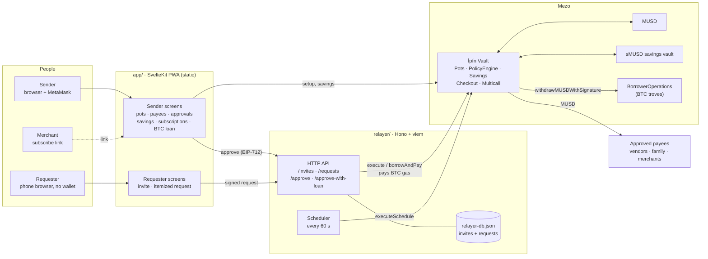
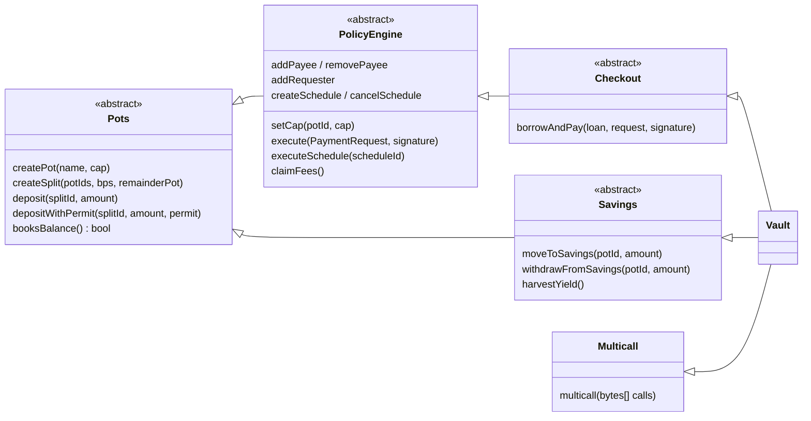
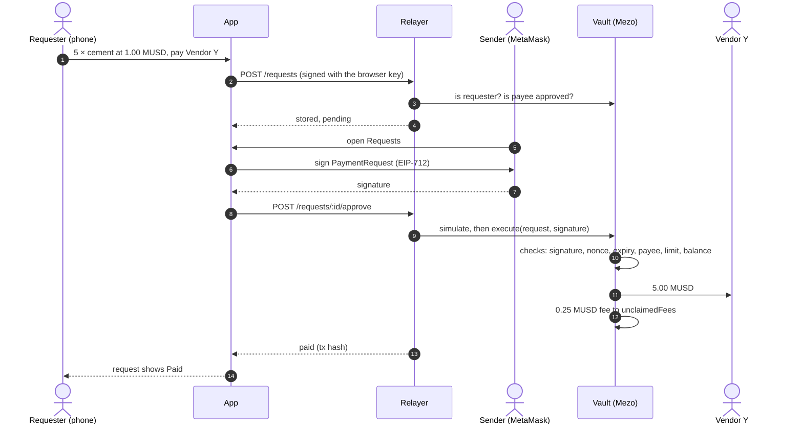
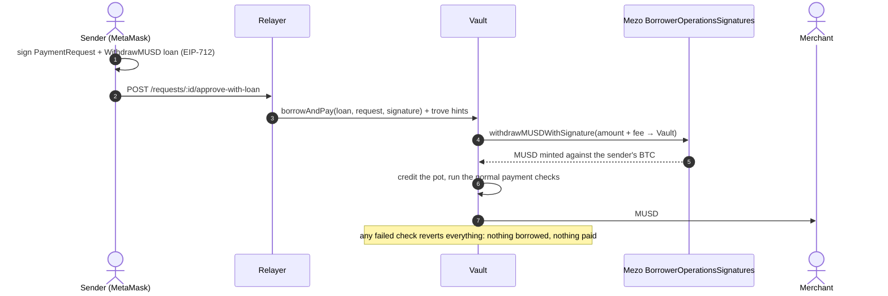

# Ìpín: Purpose-Bound Money

**Mezo Buildathon (AKINDO) · Track 2 (Access and Distribution) + Track 1 (Bitcoin-backed finance)**

Ìpín (Yoruba for "share") lets you send money for a purpose, and makes sure it can only be spent on that purpose. The money waits in MUSD (Mezo's Bitcoin-backed dollar), earns in Mezo's savings vault until it's needed, and every cent is provable on-chain.

> **One-liner:** You decide what your money is for, not whoever receives it.

- **Live app:** https://ipin-ten.vercel.app
- **Relayer health:** https://ipin.onrender.com/health
- **Live on Mezo testnet:** Vault [`0x8B6D769249e97aEefE1Bc2a60318E8297AAa7082`](https://explorer.test.mezo.org/address/0x8B6D769249e97aEefE1Bc2a60318E8297AAa7082) (verified)
- **Demo video (2 min):** https://youtu.be/nU1rUzyl1tM · Wave 1 video: https://youtu.be/MmmpK6DZjj0
- **Pitch deck:** [Google Slides](https://docs.google.com/presentation/d/1TV1C-6S-KPhzUcZUcKJrSV19zjBCZ63WyillbbS2ReY/edit?usp=sharing)
- **Try it click by click:** [docs/demo.md](docs/demo.md)

---

## The problem

Once money lands at home, the sender loses control of it, and while it waits the naira erodes its value.

*"I sent $1,000 home to build my house. Six months later, the money was gone and the foundation wasn't done."*

## What Ìpín does

A sender abroad puts MUSD into named pots, such as House and Upkeep. Money can leave a pot only:

- to a **payee the sender approved** (a vendor, a builder, a family member),
- within the pot's **monthly limit**,
- through a **request the sender signed**, a **schedule** the sender set up, or a **BTC-backed loan** the sender signed.

One on-chain policy engine checks every payment. There is no owner, no admin key, no upgrade and no "emergency" withdrawal. Anyone can call `booksBalance()` to check that the Vault holds everything it owes.

### Roles

| Role | Who | What they do |
| --- | --- | --- |
| Sender | A Nigerian abroad (UK, US, Canada, Gulf) | Funds pots, sets rules, approves requests |
| Requester | A relative or site manager | Raises purchase requests from a phone, with no wallet and no gas |
| Payee | Vendors, builders, family members, merchants | Get paid directly, within the rules |
| Merchant | A school, gym, shop or service | Makes a subscribe link; gets paid on schedule |
| Agent | An AI agent | Spends a weekly budget topped up from a pot |

### The house story

1. The sender splits 10 MUSD into a **House** pot (7.50) and an **Upkeep** pot (2.50), adds the payees and funds both, in **one transaction**.
2. The site manager opens an invite link on their phone and asks: "5 bags of cement, Vendor Y, 1.00 MUSD each."
3. The sender checks the price and approves with one signature.
4. The Vault checks the pot, payee, limit, signature, nonce and expiry, then pays Vendor Y directly. The site manager never touches the money.
5. The Upkeep pot pays Mama a monthly allowance automatically.
6. Idle House money sits in Mezo's sMUSD savings vault, earning, until the next request.
7. A request to an unapproved payee, or above the limit, is refused on-chain.

## Features

**Pots and setup**
- Named pots, each with a monthly spending limit.
- Split a deposit across pots exactly (no dust lost), with any remainder going to one named pot.
- One-transaction setup: create pots, add payees and fund them in a single signature (multicall + MUSD permit).
- Seven purpose templates: Build a house, School fees, Medical care, Shop stock, Subscriptions, AI agent budget, Pay with BTC.

**Ways money leaves a pot**

| Mode | Trigger | Example |
| --- | --- | --- |
| On request | A requester asks, the sender signs | 5 bags of cement |
| On schedule | A date, within the limit; run by the relayer | Mama's monthly allowance, a gym subscription |
| Borrow to pay | The sender signs a loan against their BTC; the Vault borrows and pays in one transaction | Paying a merchant without selling BTC |
| Agent budget | A schedule tops up an AI agent's wallet | An agent paying per call (x402) under a weekly cap |

**For requesters:** an invite link gives their phone a key that can only *ask*. They need no wallet, no crypto and no gas, and the contract refuses to pay a requester.

**Subscriptions:** a screen lists everything a pot pays on schedule, with the next date, monthly total, one-tap stop and a "short by $X" warning. A merchant makes a subscribe link without a wallet; the sender signs one transaction that approves the merchant and starts the schedule.

**Savings:** idle pot money moves into Mezo's sMUSD and comes back to the same pot. Yield is shared out per pot by index, so a late saver never takes earlier yield.

**Pay with a BTC loan:** on the approval card, the sender can pay from a BTC loan instead of the pot. The card shows the trove's collateral ratio before and after, and refuses a loan that would leave it under 150%. If any check fails, nothing is borrowed and nothing is paid.

**Statement:** every payment, fee and saving is an on-chain event, and the app shows the books-balance check as a badge.

## Mezo integration

- **MUSD** is the unit of every pot, rule and payment (18-decimal base units, EIP-2612 permit for one-transaction setup).
- **Savings in sMUSD:** the Vault deposits idle pot money into Mezo's `MUSDSavingsRate` and withdraws it back to the same pot; harvested yield is credited per pot (R10, ADR-019). Testnet sMUSD: `0x6f461c68B2c5492C0F5CCEc5a264d692aA7A8e16`. Trust assumption: sMUSD is upgradeable and its owner can change its strategy.
- **Borrow-to-pay:** the Vault calls Mezo's `BorrowerOperationsSignatures.withdrawMUSDWithSignature` with the sender's signed loan, then pays the merchant in the same transaction (R13, ADR-020). Testnet: `0xD757e3646AF370b15f32EB557F0F8380Df7D639e`. A loan signature only works through Ìpín; sent to Mezo directly it reverts, so no MUSD can be stranded.
- **Gas in BTC:** the relayer pays BTC gas so requesters need nothing, and takes a flat MUSD fee per payment.

**On-chain evidence** (Mezo testnet, all on Vault [`0x8B6D…7082`](https://explorer.test.mezo.org/address/0x8B6D769249e97aEefE1Bc2a60318E8297AAa7082)):

| What happened | Transaction |
| --- | --- |
| One-transaction setup: create House and Upkeep pots, add payees, split MUSD (`multicall`) | [`0xf74ad847…459c`](https://explorer.test.mezo.org/tx/0xf74ad8479252d06291fa7354e579f5ecda93959ad074a120eb5d9ad9423d459c) |
| Sender-approved request paid straight to the vendor (`execute`) | [`0x9a8b2a11…bd3c`](https://explorer.test.mezo.org/tx/0x9a8b2a1195af381c390985240dfa68e96cfe6c15443607740f06f015aa21bd3c) |
| Monthly allowance created (`createSchedule`) | [`0xab1ce2fb…cbea`](https://explorer.test.mezo.org/tx/0xab1ce2fb993e809545ab4d5271f6e1e8323559a4f272b501a08954303f43cbea) |
| Allowance paid by the relayer (`executeSchedule`) | [`0x1c0bd08c…6352`](https://explorer.test.mezo.org/tx/0x1c0bd08c9f01c082e0358ab5945f0e868bfec86bde3bd868c4077243feb36352) |
| Relayer fees claimed in MUSD (`claimFees`) | [`0x29a39fbc…d9f8`](https://explorer.test.mezo.org/tx/0x29a39fbcc5a08db9ac5c1801f8f8fccdee46af352bdcb7aaca3810b31436d9f8) |
| Idle pot money moved into Mezo's sMUSD (`moveToSavings`) | [`0x2ee64d05…b879`](https://explorer.test.mezo.org/tx/0x2ee64d05a58f940f1b9a1ed3365bb1d18a7e8c6a8aa7d0d7b96fb12232fab879) |
| Brought back from sMUSD to the same pot (`withdrawFromSavings`) | [`0x636f3e27…f17a`](https://explorer.test.mezo.org/tx/0x636f3e27ad4a70d2886a46aeeb12b01bb3db1c2d0e6032fe50d2efbd5957f17a) |
| Empty pot pays a merchant with MUSD borrowed against BTC (`borrowAndPay`, Mezo `withdrawMUSDWithSignature`) | [`0x3d3463a8…a467`](https://explorer.test.mezo.org/tx/0x3d3463a89506f5c2b859a911ac2c363ec4db0a85ef7f67c5f25984bd532ca467) |

Scripts that produced them: `contracts/script/Showcase.s.sol` and `contracts/script/BorrowToPay.s.sol` (rehearsed first against Mezo's real contracts on a fork with `RehearseBorrowToPay.s.sol`).

---

## Architecture

The policy engine is the only door money leaves through. A new use case, spender or payee is a configuration, never a shortcut.

### System



- **Sender** signs everything that changes a pot. Setup and savings go straight to the Vault from MetaMask; approvals and loans are EIP-712 signatures the relayer submits.
- **Requester** never holds money or gas. The sender registers the requester's key per pot, and the contract refuses to pay it.
- **Relayer** is a liveness dependency, not a safety one: it simulates every call before sending, and the Vault re-checks every rule on-chain.

### Contracts



One deployed contract: `Vault is Checkout, Savings, Multicall`. No owner, no upgrade, no sweep. The only ways MUSD leaves are payments to approved payees (`execute`, `executeSchedule`, `borrowAndPay`, all through the same checks), savings deposits that stay credited to their pot, and `claimFees` (fees already earned, to the immutable relayer address).

Every payment passes the same checks: the payee is approved and is not a requester, the amount is above zero, it fits the pot's limit for the current 30-day period, and the pot covers the amount plus the flat fee. Request payments also need the sender's EIP-712 signature (ECDSA or ERC-1271) over that exact request, with an unused nonce and an unexpired deadline.

### Request → approve → pay



### Pay with a BTC loan



### Repo layout

```
ipin/
  contracts/     Foundry: Vault (Pots, PolicyEngine, Savings, Checkout, Multicall), tests, scripts
  relayer/       TypeScript (Hono + viem): submits signed requests and loans, runs schedules
  packages/      shared: ABIs, EIP-712 types (PaymentRequest, WithdrawMUSD), Mezo ABIs, amounts
  app/           phone-first PWA (SvelteKit): sender, requester and merchant screens
  docs/          money-rules.md, decisions.md, security-review.md, api.md, agents.md, demo.md
  deployments/   mezo-testnet.json: the one source for the Vault, MUSD and relayer addresses
```

Stack: Solidity 0.8.24, Foundry, OpenZeppelin 5; TypeScript, Hono and viem for the relayer; SvelteKit / Svelte 5 for the app; pnpm workspace on Node 22.

```sh
pnpm install && git submodule update --init --recursive
pnpm check            # format, lint, all tests
pnpm test:ci          # 10k fuzz runs + deep invariants
```

---

## Money rules

Full testable statements and test names: [docs/money-rules.md](docs/money-rules.md). Each rule has a test that was written to fail first, and cites the rule ID.

| Rule | Statement |
| --- | --- |
| R1 Units | All amounts are MUSD base units (18 decimals). No floating point anywhere, app included. |
| R2 Splits | The pieces of a deposit sum to the deposit exactly. Any remainder goes to one named pot. |
| R3 Replays | Every payment request has a nonce and an expiry. A used or expired request is rejected. |
| R4 Fees | The relayer fee is a flat amount per payment, charged once, from the same pot, recorded as its own entry. |
| R5 Pending | Money awaiting provider or bank confirmation sits in a pending state: out of the pot, not yet spent. |
| R6 Refunds | A failed payout returns the full amount and the fee to the original pot. Today every payout settles in one transaction, so a failure reverts and nothing leaves. |
| R7 Caps | Each pot's limit resets every 30 days; spending in a period never exceeds it. |
| R8 Approval | A request payment executes only with the sender's signature on that exact request. |
| R9 Schedule | A scheduled payment executes at most once per period, on or after its date, to its named payee. |
| R10 Savings | Money in the savings vault stays credited to its pot, and withdrawals return to the same pot. Yield is shared per pot by index. |
| R13 Borrow-to-pay | A loan against the sender's BTC is minted to the Vault, credited to the pot and paid out in the same transaction, through the same checks; a loan signature works only through Ìpín. |

## Invariants (hold after every transaction)

- **I1:** the Vault's MUSD + savings position = pot balances + saved amounts + unclaimed fees + surplus (`booksBalance()`).
- **I2:** every deposit = the sum of the pot credits it created.
- **I3:** spending per pot per period ≤ its limit.
- **I4:** each nonce is used at most once.
- **I5:** money leaves only to an approved payee.
- **I6:** no request payment executes without the sender's approval.

Foundry invariant tests check I1–I6 with a handler that deposits, pays, schedules, saves, harvests and borrows-to-pay at random.

## Security

- **No privileged path.** No owner, no upgrade, no sweep, no test-only bypass in `src/`.
- **Defaults:** custom errors, checks-effects-interactions, `nonReentrant` on every function that moves funds, `SafeERC20` for every token call, exact pragma.
- **Two internal reviews** ([docs/security-review.md](docs/security-review.md)). The second checked savings and borrow-to-pay against Mezo's source. It fixed one medium issue (a loan signature could be used outside Ìpín, stranding MUSD) and one low issue (trove hints), and documents the rest.
- **Tests:** 109 contract tests (fuzzed), 10,000-run fuzzing in CI, invariants I1–I6, plus 167 tests across the relayer, app and shared package.

## Scope

| Area | Built | Next | Later |
| --- | --- | --- | --- |
| Pots | Pots, exact splits, monthly limits, 7 templates | Multiple senders per pot | More templates |
| Release modes | On request, on schedule, borrow-to-pay | Agents paying per call under a signed mandate (x402, ERC-1271 + Permit2) | Milestone release with photo proof |
| Spenders | Requesters on a phone, schedules, merchant subscribe links, agent weekly budgets | Approval thresholds | Telegram or WhatsApp bot |
| Payees | Approved MUSD addresses | Naira bank payouts to vendors (needs a licensed partner) | More countries |
| Funding | MUSD deposit with permit; MUSD borrowed against BTC | Recurring top-ups from the sender | Tokenized stocks as collateral |
| Savings | sMUSD with per-pot yield | — | — |
| Proof | Invariant tests, `booksBalance()`, on-chain statement | Statement export | Third-party audit |
| Chain | Mezo testnet | Mezo mainnet | Base, BNB Chain |

## Risks

| Risk | Mitigation |
| --- | --- |
| Collusion (requester and vendor fake a request) | Itemized requests, the sender checks prices before signing; milestone photos are planned |
| BTC price drop on a borrow-to-pay trove | The app refuses loans that leave the trove under 150% and shows the ratio before and after |
| sMUSD is upgradeable by Mezo | Stated as a trust assumption; savings are optional per pot |
| No naira payout partner yet | Pays approved MUSD addresses today; partner outreach ongoing |
| Relayer goes down | Payments pause but no money is at risk; the Vault re-checks every rule |

## Mezo reference

| Item | Value |
| --- | --- |
| Mezo testnet | chain `31611`, RPC `https://rpc.test.mezo.org`, explorer `https://explorer.test.mezo.org` |
| Mezo mainnet | chain `31612`, explorer `https://explorer.mezo.org` |
| Faucet | `https://faucet.test.mezo.org` |
| MUSD (testnet) | `0x118917a40FAF1CD7a13dB0Ef56C86De7973Ac503` |
| sMUSD (testnet) | `0x6f461c68B2c5492C0F5CCEc5a264d692aA7A8e16` |
| BorrowerOperationsSignatures (testnet) | `0xD757e3646AF370b15f32EB557F0F8380Df7D639e` |
| MUSD details | 18 decimals; EIP-2612 permit; EIP-712 domain `Mezo USD`, version `1` |
| Docs | `https://mezo.org/docs/developers/` · MUSD source `https://github.com/mezo-org/musd` |

## Team

- **adetyaz**: solo builder (contracts, relayer, app, design, research).

## Credits

- Testing method adapted from Penny (https://github.com/Kingnanaweb3/penny): map the money, check the rules, hunt, prove then fix, trial balance. Reused code must be open source and cited, per the buildathon rules.

---

## Build log

**Wave 1 (Oct 16–26)**
- Vault with pots, exact splits, monthly limits and approved payees; no owner, no upgrade.
- Requests signed on a phone with no wallet, approved by the sender with one EIP-712 signature, paid by the relayer.
- Monthly allowances on a schedule, run by the relayer; flat MUSD fee per payment.
- One-transaction setup (multicall + MUSD permit).
- `booksBalance()` on-chain and in the app; invariants I1–I6; rules R1–R9 tested; first security review.
- Phone-first PWA for senders and requesters; relayer on Render; app on Vercel.

**Wave 2 (Nov 2–15)**
- Savings in Mezo's sMUSD with per-pot yield (R10).
- Borrow-to-pay: pay a merchant with MUSD borrowed against BTC, in one transaction (R13), and "Pay with a BTC loan" on the approval card.
- Subscriptions screen and merchant subscribe links.
- Seven purpose templates; AI agent weekly budgets (x402, step one).
- Second security review: loan signatures only work through Ìpín (M-02), relayer trove hints (L-04).
- Redeployed and verified on Mezo testnet with an explorer link for every call.
